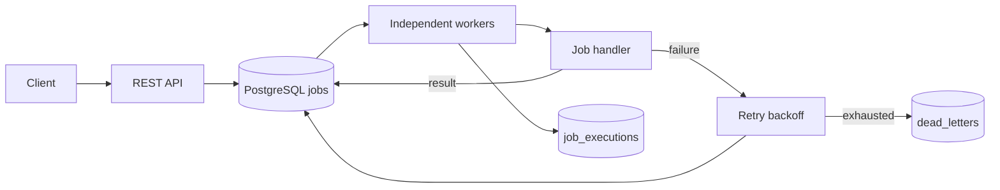

# Async Job Processing Service

A PostgreSQL-backed job processor with independently deployed API, worker and scheduler processes. It demonstrates at-least-once execution, durable retry state, per-attempt histories and worker crash recovery without requiring a message broker.

**Stack:** Java 21 · Spring Boot 3.5 · PostgreSQL 16 · Flyway · Spring JDBC · JUnit 5 · Testcontainers · Micrometer / Prometheus · GitHub Actions

## Quick start

Prerequisites: Docker Engine and Docker Compose, or Java 21 + Maven + PostgreSQL 16.

```bash
docker compose up --build -d
docker compose ps
curl http://localhost:8080/actuator/health
```

The Compose setup runs one API, one worker instance, one cron materializer and PostgreSQL. Test API behavior with `docs/requests.http`, Postman or the commands below.

```bash
# Submit asynchronously; returns HTTP 202 and a job ID immediately.
curl -i -X POST http://localhost:8080/jobs \
  -H 'Content-Type: application/json' \
  -d '{"type":"sum","payload":{"numbers":[10,20,30]},"priority":5,"maxRetries":3,"timeoutSeconds":10}'

# Replace with the returned id.
curl http://localhost:8080/jobs/<job-id>
curl http://localhost:8080/jobs/<job-id>/executions
curl http://localhost:8080/queue/depth

# Observe worker and queue metrics.
curl http://localhost:8080/actuator/prometheus
```

Scale workers independently from the API:

```bash
docker compose up -d --scale worker=3
```

To run locally without Docker for the Java process, set `DATABASE_URL`, `DATABASE_USER`, and `DATABASE_PASSWORD` (defaults documented in `src/main/resources/application.yml`), then run `mvn spring-boot:run`. Database schema is migrated automatically by Flyway.

## Built-in handler types

Handlers are registered under a small, explicit interface. Arbitrary shell commands and user-supplied code are **not** executed.

| Type | Payload | Purpose |
|---|---|---|
| `sum` | `{"numbers":[10,20,30]}` | Deterministic successful job |
| `flaky` | `{"failUntilAttempt":2}` | Fails attempts 1 and 2, succeeds attempt 3 |
| `sleep` | `{"millis":10000}` | Interruptible long task / timeout demonstration |

Additional handlers implement `JobHandler` and are annotated with `@Component`; the handler registry discovers them automatically through dependency injection.

## REST API

| Method | Path | Description |
|---|---|---|
| POST | `/jobs` | Submit one job; HTTP 202, immediate UUID response |
| GET | `/jobs/{id}` | Current status, attempt count, error, result |
| GET | `/jobs/{id}/executions` | Per-attempt history including errors and durations |
| POST | `/jobs/{id}/cancel` | Cancel a pending or retry-waiting job |
| GET | `/handlers` | Supported handler types |
| GET | `/queue/depth` | Ready, delayed, retry, running and terminal counts |
| POST | `/queue/drain` | Stop *new* claims; running jobs continue |
| POST | `/queue/resume` | Resume new claims |
| POST | `/queue/cancel-pending` | Cancel all currently unclaimed jobs |
| POST | `/schedules` | Create six-field cron recurring schedule |
| GET | `/schedules/{id}` | Read next occurrence and schedule metadata |
| DELETE | `/schedules/{id}` | Disable recurring schedule; cancel pending occurrences |
| GET | `/actuator/health` | Health status |
| GET | `/actuator/prometheus` | Prometheus scrape endpoint |

`POST /jobs` accepts `type`, `payload`, optional `priority` (-100 to 100), `maxRetries` (0 to 100), `timeoutSeconds` (1 to 86400), and optional future `runAt` in ISO-8601 UTC/offset form. `Idempotency-Key` is an optional header. The same key and same parameters return the same logical job; different parameters return HTTP 409.

**Retry semantics:** `maxRetries = 3` means up to 4 total attempts (1 original + 3 retries). On failed attempts, the next attempt waits `min(2^attemptNumber, 60)` seconds. Status `FAILED` means a failed attempt with retry pending; `DEAD_LETTERED` means the retry budget is exhausted. The most recent failure is recorded on `jobs`, and each attempt is preserved in `job_executions`.

**Timeouts:** `timeoutSeconds` applies to each attempt, not the entire logical job lifecycle. Java interruption is cooperative. Uninterruptible work requires process isolation, which is outside the scope of the reference handlers.

## Delayed and recurring scheduling

For a one-time delayed job, supply `runAt`. The queue claim query only returns rows whose `available_at <= now()`; no worker can claim that job earlier.

For recurring jobs, submit a Spring **six-field** cron expression:

```bash
curl -i -X POST http://localhost:8080/schedules \
  -H 'Content-Type: application/json' \
  -d '{"type":"sum","payload":{"numbers":[1,2]},"cronExpression":"0 0 22 * * *","timezone":"Asia/Kolkata"}'
```

The scheduler creates a **new logical job** for every occurrence. The associated `schedule_id` and `scheduled_for` uniquely identify it; retry attempts stay within that job. The scheduling loop runs every second and uses `SKIP LOCKED` for safe operation across scheduler replicas. If the scheduler is down, missed occurrences are gradually materialized on recovery. The system guarantees **not before** the due time, not exact simultaneous start at the due time.

## Architecture

- [Architecture diagram, schema and reliability semantics](docs/architecture.md)
- [Operations, scaling, metrics, security and retention](docs/operations.md)
- [DigitalOcean deployment guide](docs/digitalocean.md) (includes step-by-step App Platform setup)
- [API request examples](docs/requests.http)

## Deployment

The service deploys as three independently scalable components (API, Worker, Scheduler) from a single Docker image. Environment variables control which role each instance runs.

**DigitalOcean App Platform:** Edit `app.yaml` with your database credentials and deploy with `doctl apps create-app spec app.yaml`. See [docs/digitalocean.md](docs/digitalocean.md) for the full guide, including UI-based deployment, cost estimates, and worker scaling demonstrations.

**Local development:** `docker compose up --build -d` starts all components. Scale workers with `docker compose up -d --scale worker=3`.

### Minimal lifecycle



## Reliability and at-least-once execution

Claims are serialized through `SELECT ... FOR UPDATE SKIP LOCKED` and committed **before** handler execution. Worker leases and recovery let abandoned jobs retry. Each claim allocates a unique token and execution ID; only the current owner can commit a result, preventing stale updates. A database transaction keeps attempt history and job state consistent.

This produces at-least-once *attempt delivery* under normal durability and eventual recovery assumptions, subject to finite retry limits. It does **not** guarantee exactly-once external side effects, hard cancellation of arbitrary handlers, or successful execution after all retries fail. Use stable `job_id` as a downstream idempotency key for effectful handlers. See [architecture.md](docs/architecture.md) for specific crash windows and consistency details.

## Tests and CI

```bash
mvn -B clean verify
```

Includes unit tests for exponential backoff, handler failures, input validation and interruptibility, plus Testcontainers/PostgreSQL integration tests for API submission, atomic claiming across concurrent workers, retry/dead-letter transitions, delayed jobs, cancelled jobs, drain, cron materialization, idempotency and lease recovery. Integration tests require a running Docker daemon, including on the GitHub Actions Ubuntu runner. `.github/workflows/ci.yml` runs tests on every push and pull request.

## Worker settings

| Environment variable | Default | Effect |
|---|---|---|
| `API_ENABLED` | true | Expose HTTP domain APIs |
| `WORKER_ENABLED` | true | Start claim/recovery loops |
| `SCHEDULER_ENABLED` | true | Start cron materialization loop |
| `WORKER_CONCURRENCY` | 4 | Concurrent job claims per instance |
| `WORKER_POLL_MS` | 250 | Worker polling interval |
| `WORKER_RECOVERY_MS` | 2000 | Expired lease scan frequency |
| `WORKER_LEASE_GRACE_SECONDS` | 15 | Recovery grace after attempt timeout |
| `SCHEDULER_POLL_MS` | 1000 | Cron materialization interval |
| `SCHEDULER_BATCH_SIZE` | 100 | Number of due schedules per transaction |
| `API_KEY` | unset | If configured, require `X-API-Key` for domain and metrics APIs |

## High-load design

Scale worker replicas and tune per-instance concurrency to match handler duration and DB capacity. Monitor p95 execution duration, worker saturation, queue depth and arrival rate. Optimize indexes and claim polling, batch where appropriate, archive terminal jobs and execution history, and introduce read replicas for status lookups if needed. Multiple PostgreSQL shards or a dedicated broker become relevant when write contention or dispatch throughput is proven to be the bottleneck. Worker count alone cannot overcome downstream dependency limits. More guidance and trade-offs are in [operations.md](docs/operations.md).

## Scope and trade-offs

- Operational controls are intentionally minimal; production RBAC, per-tenant quotas, audit trails and a UI are future work.
- The cron extension materializes due occurrences rather than reserving worker capacity. Start time is best effort; it never promises strict scheduled execution deadlines.
- The service uses two executors per worker to enforce per-attempt timeout. Java interruption is cooperative; the handler pool is bounded to reduce risk from stuck handlers.
- Spring Actuator exposes Prometheus metrics; run a Prometheus collector or managed monitoring system for retention and dashboards.
- The service is deployed on DigitalOcean App Platform. See [deployment guide](docs/digitalocean.md) for setup details.

