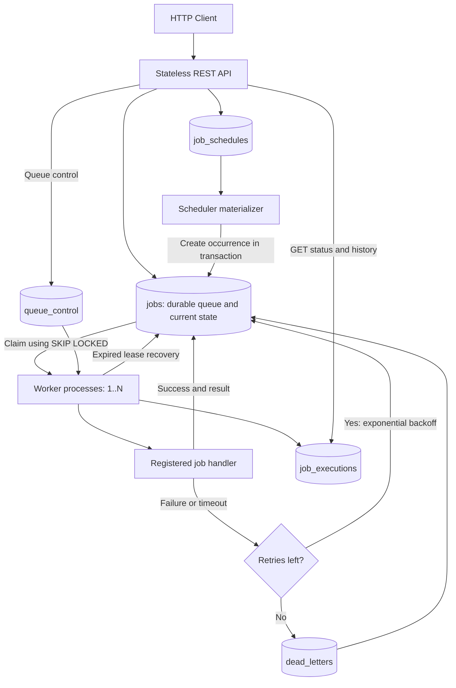
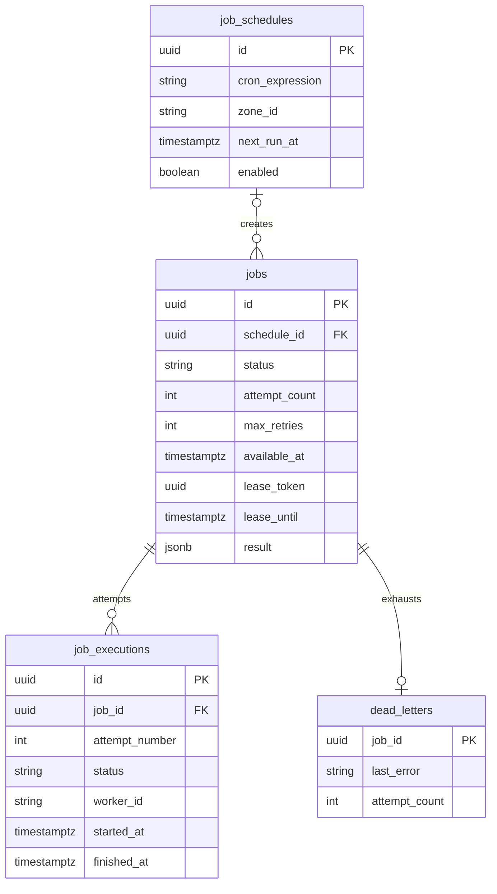

# Architecture and job lifecycle

## Components

The Spring Boot application has independently controlled components: `api`, `worker`, and `scheduler`. They use the same PostgreSQL database, but run as separate processes in Docker Compose or cloud deployments. No message broker is required.

## Data model

## State machine

`QUEUED → RUNNING → SUCCEEDED` is the success path. Failed attempts transition `RUNNING → FAILED` and set `available_at` to a future time, then transition `FAILED → RUNNING` upon claiming another attempt. Once attempt count reaches `maxRetries + 1`, transition `RUNNING → DEAD_LETTERED` and insert into `dead_letters` in the same transaction. Pending jobs may transition to `CANCELLED`. The attempt-history status is separate from the current logical-job state.

## Atomicity and delivery guarantees

1. **Submission:** PostgreSQL commits each accepted job before the HTTP 202 response. An `Idempotency-Key` avoids duplicate logical job creation on client retries (same key must imply same job request).
2. **Claim:** Within one short transaction, use `FOR UPDATE SKIP LOCKED`, mark the job `RUNNING`, allocate a lease token, increment the attempt, and insert the attempt-history row. The database lock is released **before** running the handler.
3. **Completion:** Lock the job row and accept result only if the active lease token and execution ID still match. Store result and complete the attempt in one transaction.
4. **Failure:** Mark attempt `FAILED` / `TIMED_OUT`; set the job `FAILED` with exponential backoff or dead-letter it, atomically.
5. **Crash:** Reclaim a job only after its lease expires. The recovery scanner marks the old execution `LOST` and schedules a retry or dead-letters it.

**At-least-once:** For committed jobs, assuming PostgreSQL durability, at least one healthy worker and eventual recovery, the system keeps trying until success or the configured attempt limit. This is **not** a promise of eventual success or unlimited retries. Job handlers can execute twice if an attempt makes an external side effect and its worker crashes before saving completion. Fencing tokens prevent stale database updates but do not reverse outside effects. Handlers with external side effects must use idempotency keys or downstream-side coordination. The example handlers (`sum`, `sleep`, `flaky`) have no irreversible outside effects.

**Limits:** Lease duration equals per-attempt timeout plus a grace period. Timeout enforcement is cooperative thread interruption; handlers ignoring interruption may continue doing work after timeout. Strict hard termination requires process/container isolation. PostgreSQL failover and backup are infrastructure responsibilities. One transaction per claim does not give globally fair ordering across many workers.

## Cron scheduling

The scheduler stores the next time each cron expression is due. Multiple scheduler instances select eligible schedules under `SKIP LOCKED`, create a unique `(schedule_id, scheduled_for)` job occurrence, and advance `next_run_at` in the same transaction. Cron uses Spring's **six-field** expression syntax and an explicit IANA timezone. Missed occurrences are gradually caught up, one per schedule per scan. Stopping a schedule prevents future materialization and cancels pending occurrences, but does not interrupt already-running executions.

The scheduler does not guarantee an exact wall-clock start: it only makes each job eligible no earlier than its scheduled time. Worker capacity and queue depth determine actual start latency.
